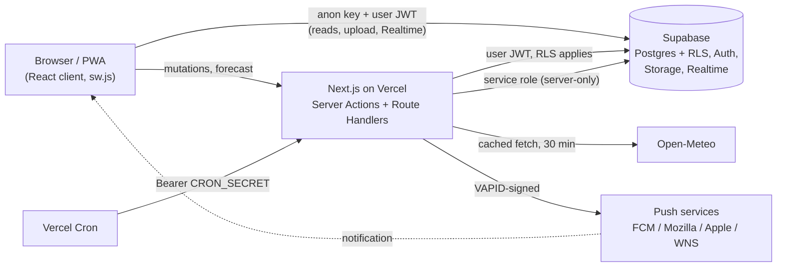

# surFriends

**קהילת הגולשים של ישראל. מי בים עכשיו, איך הגלים, ומתי לקחת את הלוח.**

A real-time surf community for Israel's coast. Surfers post short reports from the beach (photo, wave level, a line of text), friends reply "I'm coming", and a per-beach page shows the Open-Meteo wave and wind forecast. Hebrew-first, RTL, mobile-first, installable as a PWA.

Live demo: _to be added_

## Screenshots

_To be added in `docs/screenshots/`._

## Features

- **Live feed, WhatsApp-style.** Reports render as chat bubbles; new reports, replies and deletions arrive over Supabase Realtime (deduped by id, resynced on reconnect, "new reports" pill while scrolled).
- **Beach photo slider** on the home screen, backed by 12 seeded surf spots with CC-licensed photos.
- **Reports with photos.** Photos are decoded EXIF-aware, downscaled to 1600px and re-encoded as JPEG in the browser before upload. Each report carries a compact wave level (1-5) and an optional height estimate.
- **Quick reactions and reply threads.** "אני בא" / "בדרך" one-tap reactions plus one level of text replies, with optimistic updates.
- **Beach page.** Marine and wind forecast from Open-Meteo (72 hours) with a hand-rolled SVG chart, a 1-5 heuristic score, and an explicit "automatic forecast, not a surfer report" label.
- **Favorites and Web Push.** Star a beach to get a push when someone reports there; report owners get a push on reactions and replies. Per-beach and per-report cooldowns, per-device toggle plus "pause on all devices".
- **12-hour report TTL.** Reports expire after 12 hours (hidden immediately in the UI, deleted by `pg_cron` hourly; images removed by a Vercel Cron route).
- **Anonymous sign-in, name first.** No login screen: the app signs you in anonymously, then asks "what should we call you?" once. You can optionally link a Google account from the profile page to keep your profile across devices.
- **PWA.** Web manifest, icons, installable; service worker (`public/sw.js`) is registered when you opt in to notifications.
- **Hebrew RTL and accessibility.** Logical CSS properties only, `prefers-reduced-motion` honored globally, native `<dialog>` for confirmations, touch-friendly layout, Hebrew 404 and error screens.

## Tech Stack

| Layer | Technology |
| --- | --- |
| Framework | Next.js 15.5 (App Router, Server Actions, Route Handlers), React 19, TypeScript |
| Styling | Tailwind CSS v4, shadcn/ui (Base UI), lucide-react |
| Backend | Supabase: Postgres + RLS, Auth (anonymous + optional Google linking), Storage, Realtime, `pg_cron` |
| Forecast | Open-Meteo Marine + Weather APIs (no key) |
| Push | Web Push (VAPID) via `web-push` |
| Deploy | Vercel (+ Vercel Cron) |
| Package manager | pnpm |
| Tests | `node --test` (Node's built-in runner, TypeScript test files) |

## Architecture



Key decisions:

- **RLS everywhere.** Every table has Row Level Security; ownership is enforced in the database, not just in actions. Column-level `GRANT`s restrict what a user may update on `profiles` and `push_subscriptions`. `push_log` has RLS with zero policies (service role only).
- **Server-only admin client.** The service role key is used only in `lib/supabase/admin.ts` (`import "server-only"`) and the push/cron code paths. `tests/security-static.test.ts` scans the repo for violations.
- **`getClaims()` local JWT verification.** `middleware.ts` and `lib/auth.ts` verify the session JWT locally against the project JWKS instead of calling the Auth server on every request. Wrapped in `React.cache` so a render verifies once.
- **Push endpoint allowlist (SSRF).** The server POSTs to subscription endpoints, so `isAllowedPushEndpoint` accepts only https URLs on real push-service hosts (FCM, Mozilla, Apple, Windows). Writes to `push_subscriptions` go through the admin client after validation; direct INSERT/UPDATE from clients is revoked (migration `20261029060000`).
- **Rate-limit triggers.** Database triggers cap reports at 10/hour and replies at 30/hour per user, and a Storage policy caps uploads at 20/hour. The bucket accepts `image/jpeg` only.
- **Keyset pagination.** The feed pages on `(created_at, id)` with a strictly validated cursor, so identical timestamps neither skip nor duplicate rows.
- **Idempotent client ids.** The client generates the report UUID before sending; a retry hitting the same primary key is treated as success, so a lost response never creates a duplicate.
- **Cron safety.** `/api/cron/*` and `/api/push/send` require `Authorization: Bearer $CRON_SECRET` (SHA-256 + `timingSafeEqual`) and fail closed with 500 if the secret is unset.

Deeper notes live in `docs/` (see [Project structure](#project-structure)).

## Getting Started (local)

### Prerequisites

- Node.js 20+
- pnpm
- A hosted Supabase project (free tier is fine). No Docker and no Supabase CLI needed.

### 1. Install

```bash
git clone https://github.com/<your-user>/surFriends.git
cd surFriends
pnpm install
```

### 2. Create the database

In the Supabase dashboard open **SQL Editor** and run these files, in this order, each one pasted and executed once. They are idempotent.

1. `supabase/migrations/20261028000000_init_schema.sql`
2. `supabase/migrations/20261028010000_replies_reaction_without_text.sql`
3. `supabase/migrations/20261028020000_replies_unique_reaction.sql`
4. `supabase/migrations/20261029000000_reports_text_optional_with_rating.sql`
5. `supabase/migrations/20261029010000_day7_hardening.sql`
6. `supabase/migrations/20261029020000_report_ttl_cleanup.sql`
7. `supabase/migrations/20261029030000_realtime_replica_identity.sql`
8. `supabase/migrations/20261029040000_profile_hardening.sql`
9. `supabase/migrations/20261029050000_push.sql`
10. `supabase/migrations/20261029060000_push_insert_lockdown.sql`
11. `supabase/migrations/20261029070000_anonymous_users.sql`
12. `supabase/migrations/20261029080000_reply_push.sql`
13. `supabase/migrations/20261029090000_beach_names_photos.sql`
14. `supabase/migrations/20261029100000_rename_zamir_nirvana.sql`
15. `supabase/migrations/20261029110000_rename_nirvana_dash.sql`

Then run `supabase/seed.sql` (the 12 beaches). It must come after migration 13, which adds the photo columns it fills.

Optional: `supabase/dev/sample_reports.sql` inserts demo reports. It needs at least one profile, so open the app once first. Sample reports are deleted by the TTL after 12 hours; re-run the script to refresh them.

### 3. Supabase dashboard settings

- **Authentication > Sign In / Providers:** enable **Allow anonymous sign-ins** (required; the app has no login screen).
- **Optional Google linking:** enable the Google provider and **Allow manual linking** (needed for `linkIdentity`). Without them the "save your profile" card on `/profile` will report an error; everything else works.
- **Database > Extensions:** enable `pg_cron`. If migration 6 fails on `create extension pg_cron`, enable it here and re-run the migration.
- Copy the project URL, anon key and service role key from **Project Settings > API**.

### 4. Environment

```bash
cp .env.example .env.local
```

| Variable | Public (build-time) | Description |
| --- | --- | --- |
| `NEXT_PUBLIC_SUPABASE_URL` | yes | Supabase project URL. Also used by `next.config.ts` to allow Storage images. |
| `NEXT_PUBLIC_SUPABASE_ANON_KEY` | yes | Supabase anon (publishable) key. |
| `SUPABASE_SERVICE_ROLE_KEY` | no, secret | Service role key. Server-only: push sending, subscription writes, the cron route. |
| `VAPID_PUBLIC_KEY` | no | Web Push public key (raw P-256, base64url). |
| `VAPID_PRIVATE_KEY` | no, secret | Web Push private key. Never sent to the browser. |
| `NEXT_PUBLIC_VAPID_PUBLIC_KEY` | yes | Same value as `VAPID_PUBLIC_KEY`; inlined into the bundle so the browser can subscribe. |
| `VAPID_SUBJECT` | no | Contact for push services: an `https://` URL or `mailto:` address. |
| `NEXT_PUBLIC_SITE_URL` | yes | Site origin. `http://localhost:3000` locally, your production URL on Vercel. |
| `CRON_SECRET` | no, secret | Bearer secret for `/api/cron/*` and `/api/push/send`. |

Generate the VAPID keypair (copy the output into the three VAPID variables):

```bash
npx web-push generate-vapid-keys
```

Generate `CRON_SECRET`:

```bash
openssl rand -hex 32
# PowerShell: -join ((1..32) | % { '{0:x2}' -f (Get-Random -Max 256) })
```

Do not change the VAPID keys once users have subscribed; existing subscriptions are bound to the public key.

### 5. Run

```bash
pnpm dev
```

Open http://localhost:3000. Restart the dev server after editing env vars.

## Scripts

| Command | What it does |
| --- | --- |
| `pnpm dev` | `next dev --turbopack` |
| `pnpm build` | `next build` |
| `pnpm start` | `next start` (after a build) |
| `pnpm lint` | `eslint` |
| `node --test tests/*.test.ts` | Runs the test suite. There is no `test` script in `package.json`. |

`distDir` honors `NEXT_DIST_DIR`. Run verification builds with it so they do not clobber a running `pnpm dev`:

```bash
NEXT_DIST_DIR=.next-verify pnpm build
# PowerShell: $env:NEXT_DIST_DIR=".next-verify"; pnpm build
```

`.next-verify/` is git-ignored.

## Deployment (Vercel)

1. Import the repository in Vercel. The framework preset (Next.js) is detected automatically. Pushes to `main` deploy to production.
2. Add the environment variables from the table above for Production (and Preview if you want it). `NEXT_PUBLIC_*` values are baked in at build time, so redeploy after changing them. Set `NEXT_PUBLIC_SITE_URL` to the production URL.
3. **Cron.** `vercel.json` schedules `GET /api/cron/purge-images` daily at 03:00 UTC (Hobby allows daily crons only; hourly needs Pro). Vercel sends `Authorization: Bearer $CRON_SECRET` automatically. The route removes expired report images, purges old `push_log` rows, and calls `purge_expired_reports()` as a backup to `pg_cron`. Crons run on Production only.
4. **Supabase Auth URL configuration** (Authentication > URL Configuration):
   - Site URL: your production URL.
   - Redirect URLs: `https://<your-domain>/callback` (the Google link/sign-in return). Add `http://localhost:3000/callback` for local testing.
5. **Function region.** In Vercel project Settings > Functions, pick a region close to your Supabase region to cut database latency.
6. iOS push requires the app to be installed to the home screen (iOS 16.4+) and HTTPS.

## Testing and Quality

- **Tests:** `node --test tests/*.test.ts`. 101 tests, all passing. Coverage: report validation, keyset feed query, feed state/realtime merge, replies, relative time (`Asia/Jerusalem`), forecast parsing against fixtures (no network), chart geometry, push validation/allowlist, profile, splash, chat bubbles, and a static security scan (service role confined to `admin.ts`, every server action checks the session, cron routes use `timingSafeEqual` and fail closed).
- **Static checks:** `pnpm lint`, `pnpm exec tsc --noEmit`.
- **Lighthouse** (production build, `/login`, lighthouse 12). Measured before the switch to anonymous sign-in; `/login` now redirects to `/`, and signed-in/PWA pages have not been measured.

  | | Performance | Accessibility | Best Practices | SEO |
  | --- | --- | --- | --- | --- |
  | Mobile | 95 | 100 | 100 | 82 |
  | Desktop | 100 | 100 | 100 | 82 |

  Mobile: FCP 1.1s, LCP 2.6s, TBT 130ms, CLS 0. The SEO score predates the `robots.ts` and meta-description fix (BUG-030); it was not re-measured.
- **QA audit:** full findings and manual checklists in [docs/TEST_REPORT.md](./docs/TEST_REPORT.md). The two high-severity findings (BUG-001, BUG-019) and the Day 13 medium findings are fixed. Open low-severity items: BUG-007 (query errors shown as an empty state), BUG-014 (form error focus, empty-feed `h1`), BUG-017 (fonts/bundle), BUG-022 to BUG-028 (push cooldown atomicity, dialog ids, touch targets, timezone edges, PWA polish).

## Project Structure

```
app/
  (app)/                 Feed, /new, /beach/[id], /profile, /profile/[id], /settings, /credits
  api/
    forecast/[beachId]/  Open-Meteo proxy with caching
    cron/purge-images/   Daily cleanup (Vercel Cron)
    push/send, push/resubscribe
  actions/               Server Actions: reports, replies, profile, push
  callback/              OAuth return for Google linking
  manifest.ts, icon.tsx, apple-icon.tsx, pwa-icon/[size]/, robots.ts, not-found.tsx, global-error.tsx
components/              feed, forms, forecast, push, profile, settings, session, shared, mascot, ui
lib/                     supabase clients (server/client/admin), auth, feed, reports, forecast, openMeteo,
                         push, push-send, image-process, chart, realtime
public/
  sw.js                  Service worker (push only; no fetch handler, no cache)
  beaches/               Beach photos + CREDITS.md
supabase/
  migrations/            Ordered SQL migrations
  seed.sql               12 beaches
  dev/sample_reports.sql Demo data (dev only)
tests/                   node --test suites + fixtures
docs/                    ANON_AUTH, DAY7_TTL, DAY10_FORECAST, DAY12_PUSH, DESIGN_SYSTEM, TEST_REPORT, UX_SPEC
middleware.ts            Session refresh via getClaims()
vercel.json              Cron schedule
```

Docs are written in Hebrew. Start with `docs/ANON_AUTH.md` (auth model), `docs/DAY7_TTL.md` (expiry), `docs/DAY10_FORECAST.md` (forecast API and scoring), `docs/DAY12_PUSH.md` (push), and `docs/DESIGN_SYSTEM.md` (design system v4).

## Credits

- **Beach photos** are from Wikimedia Commons under CC BY / CC BY-SA licenses, resized but otherwise unmodified. Per-photo author, license and source are in [public/beaches/CREDITS.md](./public/beaches/CREDITS.md) and on the in-app `/credits` page.
- **Forecast data** by [Open-Meteo.com](https://open-meteo.com/) (CC BY 4.0). The free API is for non-commercial use; commercial use needs a paid plan and API key.

## Roadmap

From the original spec's Future list:

- [ ] Map view with real-time surfer pins
- [ ] Surf history and stats
- [ ] Hazard alerts (jellyfish, currents)
- [ ] Session planner ("tomorrow at 7")
- [ ] Carpool matching
- [ ] Instructor finder

Also worth doing: show query errors instead of an empty "quiet sea" state (BUG-007), per-beach orientation for offshore/onshore wind (currently assumes a west-facing coast), CAPTCHA on anonymous sign-in, and Lighthouse runs on the signed-in pages.

## License

MIT. See [LICENSE](./LICENSE).

## Author

**Yosef Palas** — Full-Stack Developer, Haifa, Israel.

Built as a portfolio project to showcase a modern Next.js and Supabase architecture.
