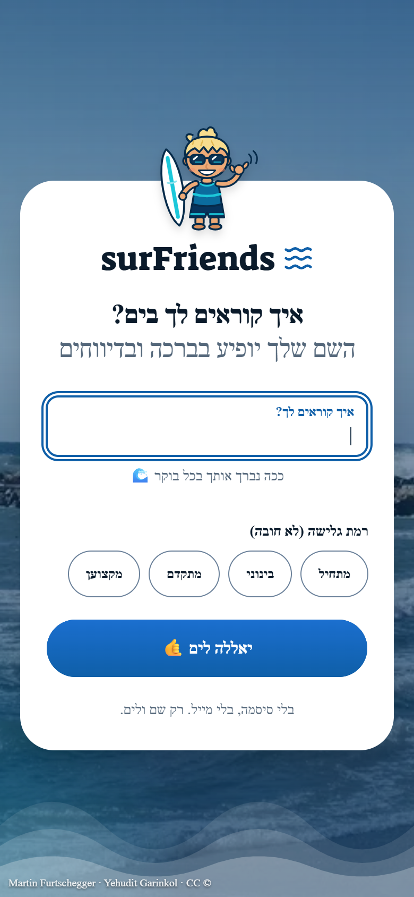
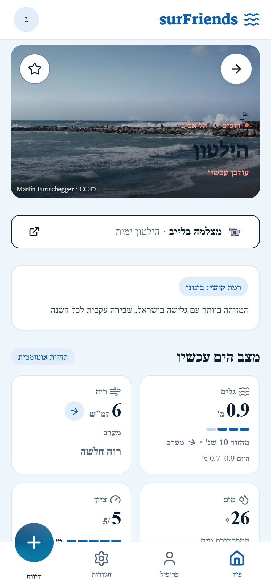
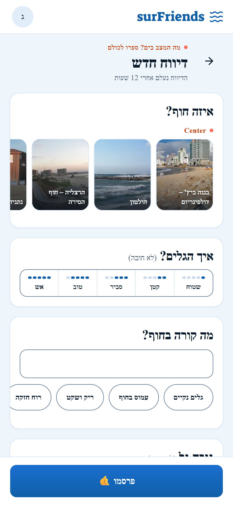
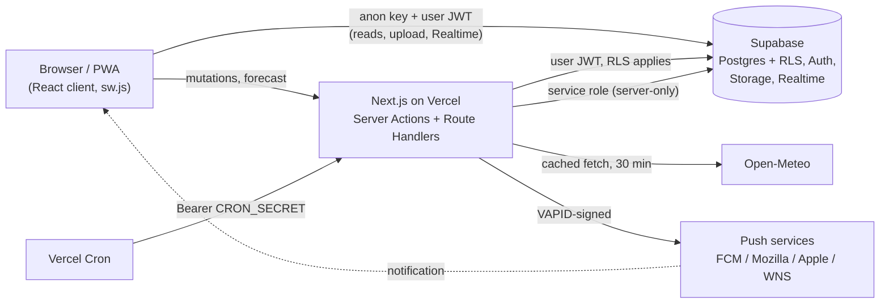

# surFriends

**קהילת הגולשים של ישראל. מי בים עכשיו, איך הגלים, ומתי לקחת את הלוח.**

A real-time surf community for Israel's coast. Surfers post short reports from the beach (photo, wave level, a line of text), friends tap "I'm coming", and every beach has a live wave and wind forecast plus a link to a public beach cam. Hebrew-first, RTL, mobile-first, installable as a PWA.

**Live:** [surfriends-app.vercel.app](https://surfriends-app.vercel.app)

## Screenshots

| Sign-up | Feed | Beach | New report |
| :---: | :---: | :---: | :---: |
|  |  |  |  |

## Features

- **No login screen.** The app signs you in anonymously and asks one question: what should we call you (plus an optional surf level).
- **Live feed, WhatsApp-style.** Reports render as chat bubbles; new reports, replies and deletions arrive over Supabase Realtime (deduped by id, resynced on reconnect, a "new reports" pill while scrolled). Long text collapses behind "עוד"; photos open full screen.
- **Reports with photos.** Photos are decoded EXIF-aware, downscaled to 1600px and re-encoded as JPEG in the browser before upload. Each report carries a wave level (1-5) and an optional height estimate.
- **Quick reactions and replies.** One-tap "אני בא" / "בדרך" plus one level of text replies, with optimistic updates.
- **Beach page.** 72-hour marine and wind forecast from Open-Meteo with a hand-rolled SVG chart and a 1-5 score, clearly labeled as an automatic forecast. Eight beaches link out to a free public live cam.
- **Favorites and Web Push.** Star a beach to get a push when someone reports there; report owners get a push on reactions and replies. Per-beach and per-report cooldowns.
- **Night mode.** Between sunset and sunrise (computed for Israel, NOAA algorithm) reporting and replies are closed, enforced in the UI, the server and the database.
- **12-hour report TTL.** Reports disappear from the UI after 12 hours and are deleted by `pg_cron`; images are removed by a Vercel Cron route.
- **PWA.** Manifest, icons, installable; the service worker (`public/sw.js`) handles push only.
- **Hebrew RTL and accessibility.** Logical CSS properties only, `prefers-reduced-motion` honored, native `<dialog>`, focus moved to the first invalid field, Hebrew 404 and error screens.

## Tech Stack

| Layer | Technology |
| --- | --- |
| Framework | Next.js 15.5 (App Router, Server Actions, Route Handlers), React 19, TypeScript |
| Styling | Tailwind CSS v4, shadcn/ui (Base UI), lucide-react |
| Backend | Supabase: Postgres + RLS, anonymous Auth, Storage, Realtime, `pg_cron` |
| Forecast | Open-Meteo Marine + Weather APIs (no key) |
| Push | Web Push (VAPID) via `web-push` |
| Deploy | Vercel (functions in `hnd1`, next to the database) + Vercel Cron |
| Tests | `node --test` (Node's built-in runner, TypeScript test files) |

## Architecture



Key decisions:

- **RLS everywhere.** Every table has Row Level Security; ownership is enforced in the database, not only in actions. Column-level `GRANT`s restrict what a user may update on `profiles` and `push_subscriptions`.
- **Server-only admin client.** The service role key lives only in `lib/supabase/admin.ts` (`import "server-only"`) and the push/cron paths. `tests/security-static.test.ts` scans the repo for violations.
- **Local JWT verification.** `middleware.ts` and `lib/auth.ts` verify the session with `getClaims()` against the project JWKS instead of calling the Auth server on every request.
- **Push endpoint allowlist (SSRF).** The server only POSTs to https URLs on real push-service hosts; clients cannot write `push_subscriptions` directly.
- **Rate limits in the database.** Triggers cap reports at 10/hour and replies at 30/hour per user; a Storage policy caps uploads at 20/hour and accepts `image/jpeg` only.
- **Keyset pagination and idempotent ids.** The feed pages on `(created_at, id)`; the client generates each report's UUID, so a retried submit can never create a duplicate.
- **Errors are not empty states.** A failed query reaches the error boundary with a retry button instead of rendering "the sea is quiet".
- **Cron safety.** `/api/cron/*` and `/api/push/send` require `Authorization: Bearer $CRON_SECRET` (`timingSafeEqual`) and fail closed if the secret is unset.

## Getting Started (local)

### Prerequisites

- Node.js 20+ and pnpm
- A hosted Supabase project (free tier is fine). No Docker or Supabase CLI needed.

### 1. Install

```bash
git clone https://github.com/yosef246/surFriends.git
cd surFriends
pnpm install
```

### 2. Create the database

In the Supabase dashboard open **SQL Editor** and run every file in `supabase/migrations/` in filename order (they are idempotent), then `supabase/seed.sql` (the 12 beaches).

Optional: `supabase/dev/sample_reports.sql` inserts demo reports. It needs at least one profile, so open the app once first.

### 3. Supabase dashboard settings

- **Authentication > Sign In / Providers:** enable **Allow anonymous sign-ins** (required).
- **Database > Extensions:** enable `pg_cron` (needed by the TTL migration).
- Copy the project URL, anon key and service role key from **Project Settings > API**.

### 4. Environment

```bash
cp .env.example .env.local
```

| Variable | Public | Description |
| --- | --- | --- |
| `NEXT_PUBLIC_SUPABASE_URL` | yes | Supabase project URL |
| `NEXT_PUBLIC_SUPABASE_ANON_KEY` | yes | Supabase anon key |
| `SUPABASE_SERVICE_ROLE_KEY` | secret | Server-only: push sending, subscription writes, cron |
| `VAPID_PUBLIC_KEY` / `VAPID_PRIVATE_KEY` | private key secret | Web Push keypair (`npx web-push generate-vapid-keys`) |
| `NEXT_PUBLIC_VAPID_PUBLIC_KEY` | yes | Same value as `VAPID_PUBLIC_KEY`, for the browser |
| `VAPID_SUBJECT` | no | `https://` URL or `mailto:` contact for push services |
| `NEXT_PUBLIC_SITE_URL` | yes | `http://localhost:3000` locally, the production URL on Vercel |
| `CRON_SECRET` | secret | Bearer secret for the cron and push routes (`openssl rand -hex 32`) |

### 5. Run

```bash
pnpm dev                      # http://localhost:3000
node --test tests/*.test.ts   # test suite
pnpm lint
```

## Deployment (Vercel)

1. Import the repository; pushes to `main` deploy to production.
2. Add the environment variables above. `NEXT_PUBLIC_*` values are baked in at build time, so redeploy after changing them.
3. `vercel.json` pins functions to `hnd1` (Tokyo, same region as this project's Supabase) and schedules `/api/cron/purge-images` daily at 03:00 UTC. Change the region to match your own Supabase project.
4. In Supabase **Authentication > URL Configuration** set the Site URL to your production URL.
5. iOS push needs the app installed to the home screen (iOS 16.4+).

## Optional: link a Google account

The code for linking an anonymous profile to Google (so it survives a new phone) is in place but hidden, because the Google OAuth consent screen is still in Testing mode. To enable it: publish the consent screen, enable the Google provider and **Allow manual linking** in Supabase, add `https://<your-domain>/callback` to the redirect URLs, and set `GOOGLE_LINK_ENABLED = true` in `app/(app)/profile/page.tsx`. Setup details: [docs/DAY1_SETUP.md](./docs/DAY1_SETUP.md).

## Testing and Quality

- **110 tests** (`node --test`): report validation, keyset feed query, realtime feed state, replies, relative time in `Asia/Jerusalem`, forecast parsing against fixtures, chart geometry, daylight/night window, push validation and allowlist, profile, and a static security scan.
- **Static checks:** `pnpm lint`, `pnpm exec tsc --noEmit`.
- **QA audit:** findings and manual checklists in [docs/TEST_REPORT.md](./docs/TEST_REPORT.md).

## Project Structure

```
app/
  (app)/                 Feed, /new, /beach/[id], /profile, /profile/[id], /settings, /credits
  api/                   forecast proxy, cron cleanup, push send/resubscribe
  actions/               Server Actions: reports, replies, profile, push
  callback/              OAuth return (Google linking, currently hidden)
components/              feed, forms, forecast, night, push, profile, session, settings, shared, mascot, ui
lib/                     Supabase clients, auth, feed, reports, forecast, daylight, push, beach-cams, realtime
public/                  sw.js, beach photos + CREDITS.md
supabase/                migrations/, seed.sql, dev/sample_reports.sql
tests/                   node --test suites + fixtures
docs/                    design system, UX spec, QA report, feature notes (Hebrew), screenshots
```

## Credits

- **Beach photos** from Wikimedia Commons under CC BY / CC BY-SA; per-photo credits in [public/beaches/CREDITS.md](./public/beaches/CREDITS.md) and on the in-app `/credits` page.
- **Forecast data** by [Open-Meteo.com](https://open-meteo.com/) (CC BY 4.0, non-commercial free tier).
- **Live cams** are external links to free public cameras (mostly [beachcam.co.il](https://beachcam.co.il)); nothing is embedded.

## License

MIT. See [LICENSE](./LICENSE).

## Author

**Yosef Palas**, AI Engineer | Full-Stack Developer, Haifa, Israel.
